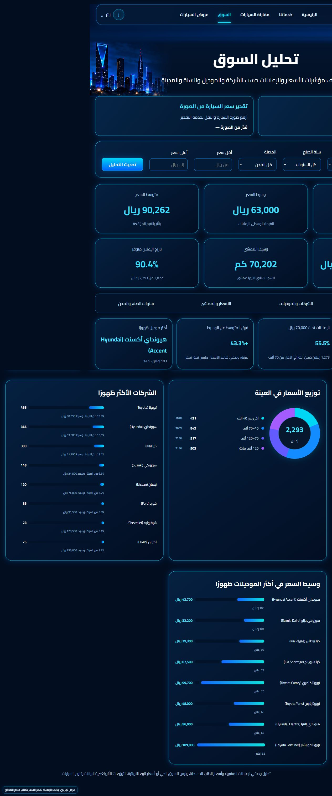
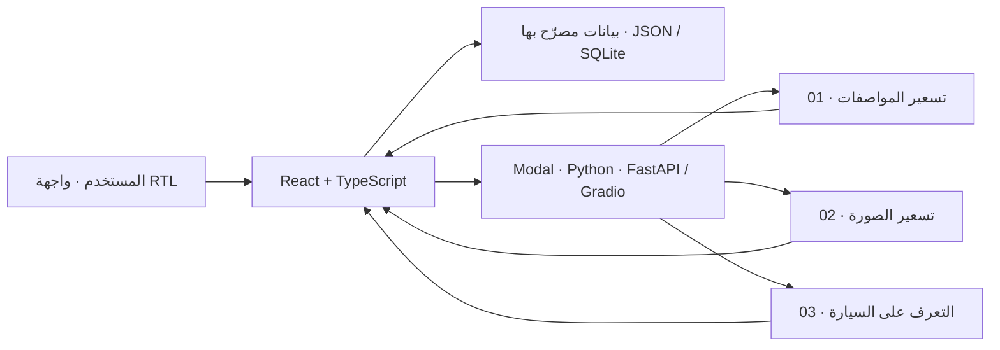

<div align="center">


# سعّر | SAER

**من صورة سيارة أو مواصفاتها… إلى تقدير مدعوم بالبيانات.**

منصة عربية تجريبية لتقدير أسعار إعلانات السيارات المستعملة، والتعرّف على الماركة والموديل، وعرض أدوات استكشاف بيانات السيارات عند توفر بيانات مصرح بها.

<br>


<br>

<a href="https://saer-rmsavg637.pages.dev/" title="افتح النسخة الحية من سعّر — النماذج تعمل عبر Modal"></a>
<a href="docs/SETUP.md"></a>
<a href="#-نتائج-النماذج--model-results"></a>

<br>


<br>

[**الواجهة**](#-واجهة-سعر) · [**البيانات**](#-البيانات-في-النسخة-العامة) · [**نتائج النماذج**](#-نتائج-النماذج--model-results) · [**كيف يعمل؟**](#-كيف-يعمل-سعر) · [**التشغيل**](#-quick-start) · [**الفريق**](#-فريق-التطوير--the-team)

</div>

> [!IMPORTANT]
> **نسخة أكاديمية تجريبية، وليست خدمة تسعير تجارية.** لا تتضمن النسخة العامة سجلات الإعلانات الأصلية أو صورها. نتائج النماذج تقديرية وليست أسعار بيع مضمونة. يعمل الموقع العام على Cloudflare Pages ويتصل بخدمة النماذج على Modal. اختُبرت المسارات الثلاثة على الموقع في 6 نوفمبر 2026؛ وقد يتأخر أول طلب بسبب بدء الحاوية أو تتوقف الخدمة عند بلوغ حدود الرصيد. **قد تختلف الأصول والبيانات المنشورة عن الملفات المتاحة في هذا المستودع العام.**

---

## ✦ الفكرة في سطر واحد

بدل الانتقال بين إعلانات كثيرة لمقارنة السيارات وأسعارها، يجمع **سعّر** الاستكشاف والتصفية والمقارنة والتحليل ومسارات التنبؤ في واجهة واحدة مصممة بالعربية ومن اليمين إلى اليسار.

<a id="-واجهة-سعر"></a>
## 🖥️ واجهة سعّر

<div align="center">
  
  <sub>لقطة فعلية من التطبيق المحلي على main بتاريخ 2 نوفمبر 2026 — ليست نموذج تصميم تخيليًا.</sub>
</div>

<br>

<table>
<tr>
<td width="50%" align="center"><strong>استعراض الإعلانات</strong><br><sub>واجهة التصفح؛ البيانات الأصلية غير مرفقة</sub><br></td>
<td width="50%" align="center"><strong>تحليل السوق</strong><br><sub>واجهة التحليل؛ تتطلب بيانات مرخصة</sub><br></td>
</tr>
</table>

<sub>[تفاصيل الصور](docs/assets/README.md): لقطات أرشيفية للواجهة قبل إزالة البيانات؛ لا تمثل بيانات النسخة العامة.</sub>

---

## 📊 البيانات في النسخة العامة

أزيلت ملفات الإعلانات والصور المأخوذة من مصادر خارجية من الإصدار الجاري. تظل واجهة استعراض الإعلانات والتحليل متاحة، لكنها تعرض حالة فارغة حتى يُضاف مصدر بيانات مسموح بمشاركته. لا تمثل لقطات الشاشة بيانات متاحة ضمن النسخة الحالية.

تفاصيل نطاق النشر: [سياسة البيانات](docs/DATA_POLICY.md).

---

## 🧠 نتائج النماذج | Model results

تتكون المنصة من **3 مسارات نمذجة مستقلة**: تقدير السعر من المواصفات، وتقدير السعر من الصورة، واقتراح هوية السيارة. هذه نتائج بحثية تاريخية وليست اختبارًا على بيانات المستودع العامة الحالية أو على السوق الحالي.

<table>
<tr>
<td width="33%" valign="top">
<h3>01 · من المواصفات</h3>
<p><strong>HistGradientBoostingRegressor</strong></p>
<p>مدخلات مثل الماركة والموديل والسنة والممشى والفئة والمدينة وناقل الحركة ونوع الوقود.</p>
<p><strong>R² = 0.8750</strong><br><strong>MAE ≈ 13,088.80 ر.س</strong></p>
<sub>وفق مقاييس العرض الأكاديمي المرفق؛ ليست هذه القيم اختبارًا خارجيًا جديدًا.</sub>
</td>
<td width="33%" valign="top">
<h3>02 · من صورة</h3>
<p><strong>DINOv2 + CLIP</strong><br>مع SVR / Ridge ensemble</p>
<p><strong>10.66%</strong><br>Median absolute percentage error</p>
<p><strong>15,910.23 ر.س</strong><br>MAE على عينة اختبار تاريخية</p>
<sub>قيم أرشيفية مرجعية وليست اختبارًا جديدًا.</sub>
</td>
<td width="33%" valign="top">
<h3>03 · هوية السيارة</h3>
<p><strong>DINOv2 + CLIP</strong><br>مع Logistic Regression</p>
<p><strong>94.58%</strong><br>Top-1 على الاختبار التاريخي</p>
<p><strong>59 فئة</strong><br>مشتركة للماركة والموديل</p>
<sub>تُعرض الهوية كمقترح يتطلب تأكيد المستخدم.</sub>
</td>
</tr>
</table>

تعرض مؤشرات النماذج القديمة في الملفات المرجعية للسياق البحثي، وليست اختبارًا على البيانات التي يتيحها هذا المستودع الآن. لا يمكن إعادة إنتاج التقييم الأصلي دون البيانات وحقوق استخدامها.

| المقياس | القيمة | التوضيح |
|:---|---:|:---|
| **MedAPE** | **10.66%** | وسيط نسبة الخطأ المطلق |
| **MAE** | **15,910.23 ر.س** | متوسط الخطأ المطلق بالريال |
| **R²** | **0.8476** | جودة الملاءمة على مجموعة الاختبار المحددة |
| ضمن ±10% | **47.25%** | نسبة التقديرات ضمن 10% من السعر المسجل |
| ضمن ±20% | **75.94%** | نسبة التقديرات ضمن 20% |
| ضمن ±30% | **88.12%** | نسبة التقديرات ضمن 30% |

```text
ضمن ±10%   █████████░░░░░░░░░░░   47.25%
ضمن ±20%   ███████████████░░░░░   75.94%
ضمن ±30%   ██████████████████░░   88.12%
```

<sub>المصدر: [مؤشرات النموذج المعتمد لتسعير الصور](models/image_price_current.json) و[مؤشرات نموذج اقتراح الهوية](models/identity_current.json). كانت مجموعة الاختبار التاريخية معروفة في مراحل التطوير؛ لا تعني هذه النتائج دقة مؤكدة على بيانات جديدة أو أسعار البيع الفعلية. قيم نموذج المواصفات من العرض الأكاديمي، وتفاصيل التحقق المرفقة به.</sub>

### مثال تشغيل محلي موثق — وليس معدل دقة

| المسار | مثال النتيجة |
|:---|:---|
| السعر من المواصفات | **80,013.91 ر.س** |
| السعر من الصورة | **87,053.29 ر.س** |
| التعرف على المركبة | **Toyota Camry** |

هذه أمثلة تاريخية من جلسات اختبار محلية، وليست قياسات جديدة للدقة. أُجري اختبار وظيفي مستقل للنماذج الثلاثة على الموقع المنشور في 6 نوفمبر 2026.

---

## 🚀 إمكانات المنصة

| الميزة | ماذا تقدّم؟ |
|:---|:---|
| 💰 **تقدير سعر السيارة من المواصفات** | مدخلات منظمة ← سعر إعلان تقديري بالريال |
| 📷 **تقدير السعر من الصورة** | رفع صورة ← تقدير تجريبي ونطاقات تنبؤ |
| 🚘 **التعرّف على الماركة والموديل** | اقتراح هوية السيارة من صورة مع تأكيد المستخدم |
| 🔎 **استعراض الإعلانات** | البحث والتصفية عند توفر بيانات مصرح بها |
| 🎯 **اقتراح سيارات حسب الميزانية** | اقتراح خيارات عند توفير البيانات |
| ⚖️ **مقارنة سيارتين** | مقارنة مواصفات وبيانات متاحة |
| 📈 **تحليل السوق** | مؤشرات وصفية بعد إضافة البيانات |

---

## 🏗️ كيف يعمل سعّر؟



| الطبقة | التقنيات المستخدمة |
|:---|:---|
| **Frontend** | React 19 · TypeScript · Vite · Arabic RTL |
| **Model API** | Python 3.12 · FastAPI · Gradio |
| **Machine Learning** | scikit-learn · PyTorch · Transformers |
| **Data** | SQLite · CSV · JSON |
| **Static hosting** | Cloudflare Pages |
| **Inference hosting** | Modal (CPU; scales to zero) |

**النشر الحالي:** الواجهة على Cloudflare Pages والنماذج الثلاثة على Modal. قد يطول الطلب الأول عند بدء الحاوية ويعتمد استمرار الخدمة على الرصيد. [دليل النشر](docs/DEPLOYMENT.md).

---

<a id="-quick-start"></a>

## 🚀 Quick Start

### 1. Explore the interface locally

From a fresh clone, in **PowerShell**. Tested with Node **24.22.1** and pnpm **11.25.0**:

```powershell
git clone https://github.com/rayan18q-bot/saer.git
cd saer
pnpm --dir frontend install --frozen-lockfile
Copy-Item frontend/.env.example frontend/.env.local
pnpm --dir frontend dev
```

Open **http://127.0.0.1:5173** and choose guest access. Browsing works without a model server, but the public repository contains no advertisement records. The public repository can be cloned without an invitation.

### 2. Enable local model inference

From the **repository root**, use Python **3.12** and two fresh environments. The image worker is isolated because its saved artifact requires a different scikit-learn version.

```powershell
Remove-Item Env:PYTHONPATH -ErrorAction SilentlyContinue
Remove-Item Env:SAER_IMAGE_PYTHONPATH -ErrorAction SilentlyContinue
$env:PYTHONNOUSERSITE='1'
py -3.12 -m venv .runtime/clean-main
py -3.12 -m venv .runtime/clean-image
.runtime/clean-main/Scripts/python.exe -m pip install -r requirements-runtime-lock.txt
.runtime/clean-image/Scripts/python.exe -m pip install -r requirements-image-lock.txt
.runtime/clean-main/Scripts/python.exe tools/restore_public_encoders.py --download
./tools/start_runtime.ps1 -Mode gradio
```

With the frontend still running, open:

**http://127.0.0.1:5173/?api=http%3A%2F%2F127.0.0.1%3A7863**

The first encoder restore needs internet access and disk space. After restoration, the launch script verifies the cache and starts offline inference. It reports an error when assets or the service are unavailable; it does not substitute saved predictions.

**[دليل التشغيل](docs/SETUP.md)** يوضح تثبيت الواجهة وتشغيلها دون نشر بيانات خارجية. [دليل Cloudflare وModal](docs/DEPLOYMENT.md) يشرح إعداد الربط وفروق النسخة العامة عن ملفات النشر. The tested platform is Windows x64 with 16 GB RAM; other platforms and GPU configurations have not been verified with these locks.

<a name="team"></a>

## 👥 فريق التطوير | The Team

- ريان القحطاني
- محمد ال حمود
- عبد الرحمن الاسمري

## 🗂️ دليل المستودع | Repository Guide

| Path | Purpose |
|---|---|
| [`frontend/`](frontend/) | Arabic RTL interface and design assets; empty public demo data |
| [`backend/`](backend/) · [`hf_backend/`](hf_backend/) | REST API and the Gradio model service |
| [`models/`](models/) · [`outputs/`](outputs/) | Approved runtime artifacts, pointers, and model code |
| `data/` | Local data directory, excluded from public commits |
| [`scripts/`](scripts/) · [`tools/`](tools/) | Existing ML code, runtime workers, verification, and recovery tools |
| [`tests/`](tests/) · [`docs/`](docs/) | Frontend behavior tests, setup guides, and verification records |

<a name="documentation"></a>

## 📚 التوثيق | Documentation

| Start here | Details |
|---|---|
| [Setup & configuration](docs/SETUP.md) | Reproducible PowerShell instructions and operating notes, in English |
| [Model design & scope](ML_SPEC.md) | Original design and subsequent model decisions; early alternatives are not all implemented |
| [Data policy](docs/DATA_POLICY.md) | Public data scope and redistribution precautions |


<details>
<summary><strong>Scope, limitations & attribution</strong></summary>

- Recorded asking prices are historical, not live offers or completed sale prices.
- Not every flow, device size, or external image source has been tested. Cached encoders were verified; a complete fresh download on another machine remains untested.
- The separate image-price artifact retains its upstream provenance in [the model pointer](models/image_price_current.json). Identity diagnostics mentioned in older metadata are not additional active models in the interface.
- The Cairo font includes its [SIL Open Font License](frontend/public/fonts/OFL.txt). No repository-wide software license is declared, and no blanket redistribution rights are asserted for third-party model weights or vehicle/design imagery. Review the existing provenance and permissions before redistribution.
- Older repository revisions and independently deployed copies may still contain withdrawn records; see [Data policy](docs/DATA_POLICY.md).

</details>
