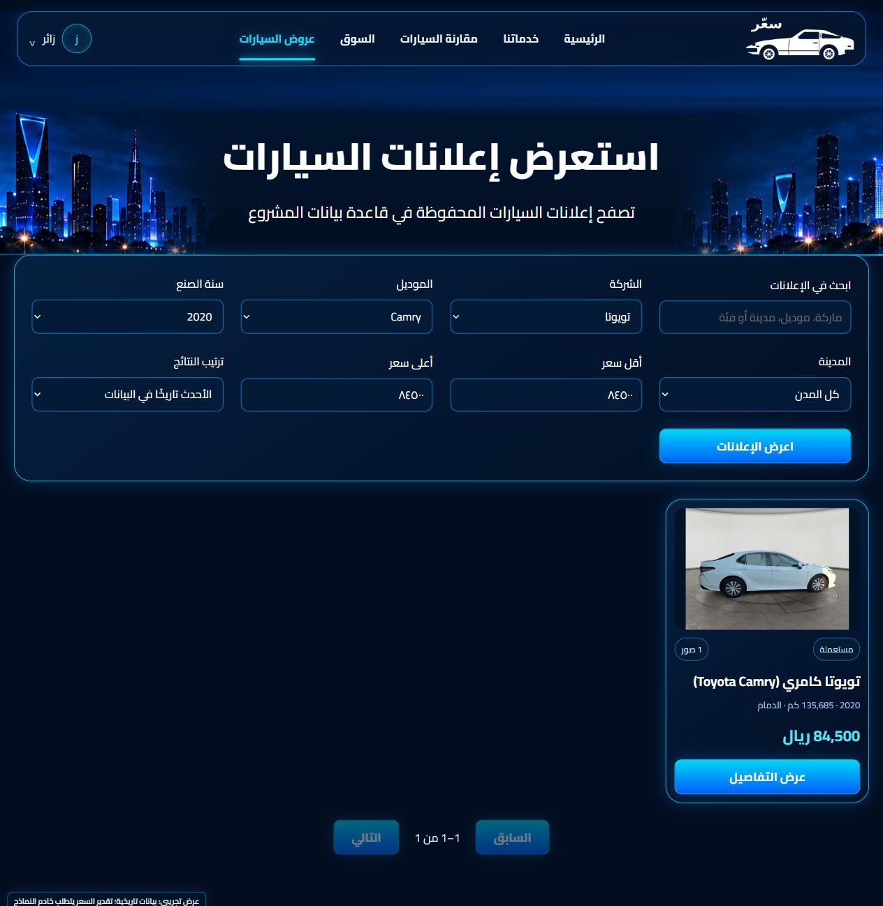
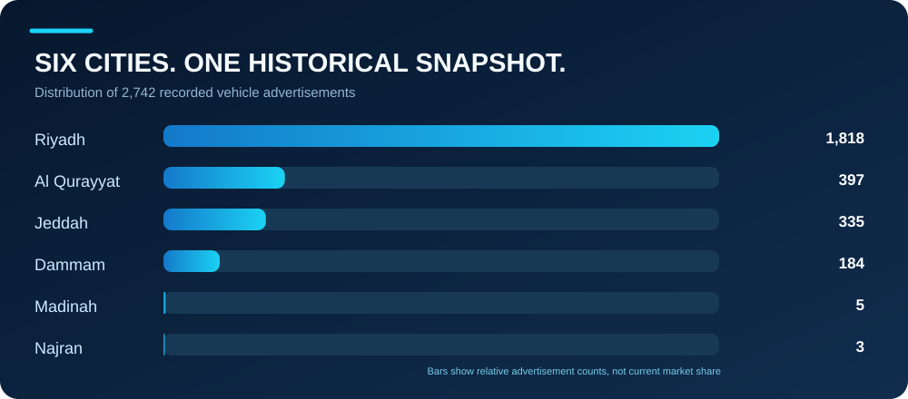
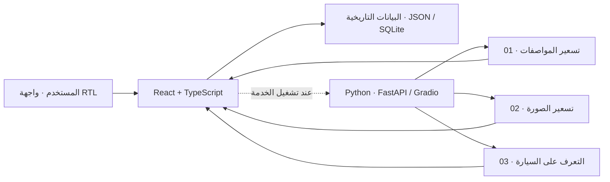

<div align="center">


# سعّر | SAER

**من صورة سيارة أو مواصفاتها… إلى تقدير مدعوم بالبيانات.**

منصة عربية تجريبية لتقدير أسعار إعلانات السيارات المستعملة، والتعرّف على الماركة والموديل، واستكشاف بيانات سوق السيارات السعودي.

<br>


<br>

<a href="https://saer-rmsavg637.pages.dev/"></a>
<a href="docs/SETUP.md"></a>
<a href="#-نتائج-النماذج--model-results"></a>

<br>


<br>

[**الواجهة**](#-واجهة-سعر) · [**البيانات**](#-بيانات-المشروع--data-at-a-glance) · [**نتائج النماذج**](#-نتائج-النماذج--model-results) · [**كيف يعمل؟**](#-كيف-يعمل-سعر) · [**التشغيل**](#-quick-start) · [**الفريق**](#-فريق-التطوير--the-team)

</div>

> [!IMPORTANT]
> **نسخة أكاديمية تجريبية، وليست خدمة تسعير تجارية.** جميع بيانات الإعلانات تاريخية، ونتائج النماذج تقديرية وليست أسعار بيع مضمونة. يعمل الرابط المنشور كواجهة ثابتة على Cloudflare Pages؛ أما التنبؤات فتتطلب خدمة Python منفصلة قيد التشغيل. قد تختلف نسخة الموقع المنشورة عن آخر تحديث في هذا المستودع.

---

## ✦ الفكرة في سطر واحد

بدل الانتقال بين إعلانات كثيرة لمقارنة السيارات وأسعارها، يجمع **سعّر** الاستكشاف والتصفية والمقارنة والتحليل ومسارات التنبؤ في واجهة واحدة مصممة بالعربية ومن اليمين إلى اليسار.

<a id="-واجهة-سعر"></a>
## 🖥️ واجهة سعّر

<div align="center">
  
  <sub>لقطة فعلية من التطبيق المحلي على main بتاريخ 2 نوفمبر 2026 — ليست نموذج تصميم تخيليًا.</sub>
</div>

<br>

<table>
<tr>
<td width="50%" align="center"><strong>استعراض الإعلانات</strong><br><sub>بحث وتصفية داخل مجموعة الإعلانات التاريخية</sub><br></td>
<td width="50%" align="center"><strong>تحليل السوق</strong><br><sub>مؤشرات ورسوم وصفية للبيانات المسجلة</sub><br></td>
</tr>
</table>

<sub>تفاصيل ومصدر اللقطات: [توثيق الصور](docs/assets/README.md). الأسعار المعروضة في الإعلانات أسعار طلب مسجلة وليست نتائج تنبؤ.</sub>

---

<a id="-بيانات-المشروع--data-at-a-glance"></a>
## 📊 بيانات المشروع | Data at a glance

<div align="center">
<table>
<tr>
<td align="center" width="25%"><h2>2,742</h2><sub>إعلان سيارة تاريخي</sub></td>
<td align="center" width="25%"><h2>13,416</h2><sub>سجل صورة في البيانات</sub></td>
<td align="center" width="25%"><h2>6</h2><sub>مدن سعودية</sub></td>
<td align="center" width="25%"><h2>2018–2026</h2><sub>سنوات الموديلات الممثلة</sub></td>
</tr>
</table>
</div>



| المدينة | عدد الإعلانات | نسبة المجموعة الكاملة |
|:---|---:|---:|
| الرياض | **1,818** | **66.3%** |
| القريات | 397 | 14.5% |
| جدة | 335 | 12.2% |
| الدمام | 184 | 6.7% |
| المدينة المنورة | 5 | 0.2% |
| نجران | 3 | 0.1% |
| **الإجمالي** | **2,742** | **100%** |

<sub>حُسبت النسب من أعداد المدن الواردة في عرض المشروع، وقد تختلف نسب مجموعات التدريب الفرعية عن إجمالي الإعلانات. الأرقام تقريبية إلى منزلة عشرية واحدة.</sub>

**كيف جُهزت عينة التسعير؟**

```text
2,742  إعلانات تاريخية
  │
  ├── استبعاد 438 سيارة جديدة (خارج نطاق المستعمل)
  ├── استبعاد  11 سيارة بممشى غير معتاد
  ▼
2,293  إعلانًا في مجموعة السعر
  │
  ├── تدريب   1,591
  ├── تحقق      357
  └── اختبار    345
```

> [!NOTE]
> **13,416** تمثل سجلات الصور في البيانات، **وليست** 13,416 ملف صورة متاحًا للتنزيل من المستودع. المستودع العام يحتوي صورة إعلان أصلية واحدة ضمن العينة، مع ملفات صور خاصة بالتصميم والواجهة. راجع [حدود صور العينة](docs/SAMPLE_IMAGES.md).

---

<a id="-نتائج-النماذج--model-results"></a>
## 🧠 نتائج النماذج | Model results

تتكون المنصة من **3 مسارات نمذجة مستقلة**: تقدير السعر من المواصفات، وتقدير السعر من الصورة، واقتراح هوية السيارة. هذه النتائج **داخلية/تاريخية** وليست اختبارًا خارجيًا على السوق الحالي.

<table>
<tr>
<td width="33%" valign="top">
<h3>01 · من المواصفات</h3>
<p><strong>HistGradientBoostingRegressor</strong></p>
<p>مدخلات مثل الماركة والموديل والسنة والممشى والفئة والمدينة وناقل الحركة ونوع الوقود.</p>
<p><strong>R² = 0.8750</strong><br><strong>MAE ≈ 13,088.80 ر.س</strong></p>
<sub>وفق مقاييس العرض الأكاديمي المرفق؛ ليست هذه القيم اختبارًا خارجيًا جديدًا.</sub>
</td>
<td width="33%" valign="top">
<h3>02 · من صورة</h3>
<p><strong>DINOv2 + CLIP</strong><br>مع SVR / Ridge ensemble</p>
<p><strong>10.66%</strong><br>Median absolute percentage error</p>
<p><strong>15,910.23 ر.س</strong><br>MAE على عينة اختبار تاريخية</p>
<sub>345 إعلانًا / 1,670 صورة في اختبار النموذج المحفوظ.</sub>
</td>
<td width="33%" valign="top">
<h3>03 · هوية السيارة</h3>
<p><strong>DINOv2 + CLIP</strong><br>مع Logistic Regression</p>
<p><strong>94.58%</strong><br>Top-1 على الاختبار التاريخي</p>
<p><strong>59 فئة</strong><br>مشتركة للماركة والموديل</p>
<sub>تُعرض الهوية كمقترح يتطلب تأكيد المستخدم.</sub>
</td>
</tr>
</table>

### دقة نموذج السعر من الصورة — على الاختبار التاريخي

| المؤشر | القيمة | التفسير |
|:---|---:|:---|
| **MedAPE** | **10.66%** | وسيط نسبة الخطأ المطلق |
| **MAE** | **15,910.23 ر.س** | متوسط الخطأ المطلق بالريال |
| **R²** | **0.8476** | جودة الملاءمة على مجموعة الاختبار المحددة |
| ضمن ±10% | **47.25%** | نسبة التقديرات ضمن 10% من السعر المسجل |
| ضمن ±20% | **75.94%** | نسبة التقديرات ضمن 20% |
| ضمن ±30% | **88.12%** | نسبة التقديرات ضمن 30% |

```text
ضمن ±10%   █████████░░░░░░░░░░░   47.25%
ضمن ±20%   ███████████████░░░░░   75.94%
ضمن ±30%   ██████████████████░░   88.12%
```

<sub>المصدر: [مؤشرات النموذج المعتمد لتسعير الصور](models/image_price_current.json) و[مؤشرات نموذج اقتراح الهوية](models/identity_current.json). كانت مجموعة الاختبار التاريخية معروفة في مراحل التطوير؛ لا تعني هذه النتائج دقة مؤكدة على بيانات جديدة أو أسعار البيع الفعلية. قيم نموذج المواصفات من العرض الأكاديمي، وتفاصيل التحقق المرفقة به.</sub>

### مثال تشغيل محلي موثق — وليس معدل دقة

| المسار | مثال النتيجة |
|:---|:---|
| السعر من المواصفات | **80,013.91 ر.س** |
| السعر من الصورة | **87,053.29 ر.س** |
| التعرف على المركبة | **Toyota Camry** |

هذه أمثلة لطلبات اختبار محلية محفوظة في [تقرير التحقق](docs/UNIFICATION_VERIFICATION.json). **لا** تُستخدم لإثبات صحة جميع التنبؤات أو اتصال نموذج بموقع Cloudflare المنشور.

---

## 🚀 إمكانات المنصة

| الميزة | ماذا تقدّم؟ |
|:---|:---|
| 💰 **تقدير سعر السيارة من المواصفات** | مدخلات منظمة ← سعر إعلان تقديري بالريال |
| 📷 **تقدير السعر من الصورة** | رفع صورة ← تقدير تجريبي ونطاقات تنبؤ |
| 🚘 **التعرّف على الماركة والموديل** | اقتراح هوية السيارة من صورة مع تأكيد المستخدم |
| 🔎 **استعراض الإعلانات** | البحث والتصفية في البيانات التاريخية |
| 🎯 **اقتراح سيارات حسب الميزانية** | عرض ما يصل إلى 5 خيارات بحسب الميزانية |
| ⚖️ **مقارنة سيارتين** | مقارنة المواصفات وأسعار الطلب المسجلة |
| 📈 **تحليل السوق** | مؤشرات ورسوم وصفية للعينة التاريخية |

---

## 🏗️ كيف يعمل سعّر؟



| الطبقة | التقنيات المستخدمة |
|:---|:---|
| **Frontend** | React 19 · TypeScript · Vite · Arabic RTL |
| **Model API** | Python 3.12 · FastAPI · Gradio |
| **Machine Learning** | scikit-learn · PyTorch · Transformers |
| **Data** | SQLite · CSV · JSON |
| **Static hosting** | Cloudflare Pages |

**حدود النشر:** Cloudflare Pages يستضيف الواجهة والملفات الثابتة فقط، وليس أوزان النماذج أو خدمة Python. تشغيل التنبؤ يتطلب إعداد الخدمة بشكل مستقل، وقد لا يكون متاحًا على الرابط العام في كل وقت.

---

<a id="-quick-start"></a>

## 🚀 Quick Start

### 1. Explore the interface locally

From a fresh clone, in **PowerShell**. Tested with Node **24.22.1** and pnpm **11.25.0**:

```powershell
git clone https://github.com/rayan18q-bot/saer.git
cd saer
pnpm --dir frontend install --frozen-lockfile
Copy-Item frontend/.env.example frontend/.env.local
pnpm --dir frontend dev
```

Open **http://127.0.0.1:5173** and choose guest access. Historical browsing does not require a model server. The public repository can be cloned without an invitation.

### 2. Enable local model inference

From the **repository root**, use Python **3.12** and two fresh environments. The image worker is isolated because its saved artifact requires a different scikit-learn version.

```powershell
Remove-Item Env:PYTHONPATH -ErrorAction SilentlyContinue
Remove-Item Env:SAER_IMAGE_PYTHONPATH -ErrorAction SilentlyContinue
$env:PYTHONNOUSERSITE='1'
py -3.12 -m venv .runtime/clean-main
py -3.12 -m venv .runtime/clean-image
.runtime/clean-main/Scripts/python.exe -m pip install -r requirements-runtime-lock.txt
.runtime/clean-image/Scripts/python.exe -m pip install -r requirements-image-lock.txt
.runtime/clean-main/Scripts/python.exe tools/restore_public_encoders.py --download
./tools/start_runtime.ps1 -Mode gradio
```

With the frontend still running, open:

**http://127.0.0.1:5173/?api=http%3A%2F%2F127.0.0.1%3A7863**

The first encoder restore needs internet access and disk space. After restoration, the launch script verifies the cache and starts offline inference. It reports an error when assets or the service are unavailable; it does not substitute saved predictions.

**[Full setup guide →](docs/SETUP.md)** includes environment checks, exact CPU versions, REST startup, configuration, fresh-result verification, build commands, and backup restoration. The tested platform is Windows x64 with 16 GB RAM; other platforms and GPU configurations have not been verified with these locks.

<a name="team"></a>

## 👥 فريق التطوير | The Team

- ريان القحطاني
- محمد ال حمود
- عبد الرحمن الاسمري

## 🗂️ دليل المستودع | Repository Guide

| Path | Purpose |
|---|---|
| [`frontend/`](frontend/) | Arabic RTL interface, design assets, and historical demo exports |
| [`backend/`](backend/) · [`hf_backend/`](hf_backend/) | REST API and the Gradio model service |
| [`models/`](models/) · [`outputs/`](outputs/) | Approved runtime artifacts, pointers, and model code |
| [`data/`](data/) | Selected processed tables and the SQLite seed; not the full photo dataset |
| [`scripts/`](scripts/) · [`tools/`](tools/) | Existing ML code, runtime workers, verification, and recovery tools |
| [`tests/`](tests/) · [`docs/`](docs/) | Frontend behavior tests, setup guides, and verification records |

<a name="documentation"></a>

## 📚 التوثيق | Documentation

| Start here | Details |
|---|---|
| [Setup & configuration](docs/SETUP.md) | Reproducible PowerShell instructions and operating notes, in English |
| [Model design & scope](ML_SPEC.md) | Original design and subsequent model decisions; early alternatives are not all implemented |
| [Data contract](DATA_CONTRACT.md) | Dataset conventions, cleaning, and provenance requirements |
| [Verification after unification](docs/UNIFICATION_VERIFICATION.json) | Actual build, frontend, and local model checks |
| [Reproducibility report](docs/PHASE4_REPRODUCIBILITY.md) | Independent environments, cache use, and remaining installation limits |
| [Delivery & presentation guide](DELIVERY.md) | Current handoff state, demonstration steps, snapshots, and history |
| [Project progress](PROGRESS.md) | Dated implementation and verification records |

<details>
<summary><strong>Scope, limitations & attribution</strong></summary>

- Recorded asking prices are historical, not live offers or completed sale prices.
- Not every flow, device size, or external image source has been tested. Cached encoders were verified; a complete fresh download on another machine remains untested.
- The separate image-price artifact retains its upstream provenance in [the model pointer](models/image_price_current.json). Identity diagnostics mentioned in older metadata are not additional active models in the interface.
- The Cairo font includes its [SIL Open Font License](frontend/public/fonts/OFL.txt). No repository-wide software license is declared, and no blanket redistribution rights are asserted for third-party model weights or vehicle/design imagery. Review the existing provenance and permissions before redistribution.
- Earlier phase reports describe the state at their dates. Current runtime instructions live in [Setup](docs/SETUP.md); branch histories and delivery checksums belong in [Delivery](DELIVERY.md).

</details>
